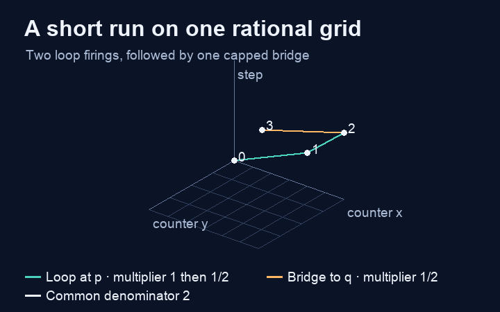

# Reachability in Unary Signed Continuous VASS

  

**Q1568.** Ajdarów, Balasubramanian and Orlikowski ask in §6 of CONCUR 2026 for the complexity of reachability and coverability of unary d-CVASS with integer updates over unrestricted rational semantics in any fixed dimension d ≥ 2. [Problem source](https://doi.org/10.4230/LIPIcs.CONCUR.2026.7)

Both problems are NL-complete under deterministic logspace many-one reductions in every fixed positive dimension. Updates are integers, endpoint coordinates are rational with unary numerator and denominator magnitudes, and all intermediate counter values may be signed.

[Read the paper](paper/manuscript.pdf) · [Proof](proof/PROBLEM_AND_PROOF.md) · [Version DOI](https://doi.org/10.5281/zenodo.24588801) · [Citation](CITATION.cff)

## Worked example

From p(0,0), fire the (2,0) loop with multipliers 1 and 1/2, then the bridge (−1,3) with multiplier 1/2, to reach q(5/2,3/2). All three firings use denominator 2. The bridge is traversed exactly once.

[Download the offline 3D explorer](https://raw.githubusercontent.com/DannyExperiments/unary-signed-continuous-vass/v1.0.0/visualization/common-grid-witness-explorer.zip). Extract it and open `index.html`. [Figure guide](visualization/README.md)

## Proof and verification

For the support of a successful run, the components form a chain connected by one-shot bridges. An edge-total linear program maximizes a common positive lower bound on used edges and caps bridges at 1. At a vertex, substituting active bounds leaves at most d independent free columns. A fixed-size determinant gives polynomially bounded totals on one grid. An internal detour construction and integer allocation realize those totals as positive firings on a short walk. The walk can be streamed in logarithmic space.

The exact replay checks 43,680 grid allocation fixtures, the worked reachability example, signed coverability, and a zero-length run. These small exact tests illustrate specific steps. The paper gives the analytic proof.

[Reproducibility](REPRODUCIBILITY.md) · [Prior work](audits/public_safe_reports/LITERATURE_AUDIT.md) · [Scope](CLAIM_SCOPE_AND_LIMITATIONS.md) · [AI disclosure](AI_DISCLOSURE.md)
